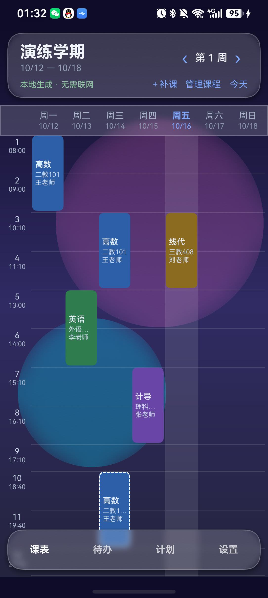
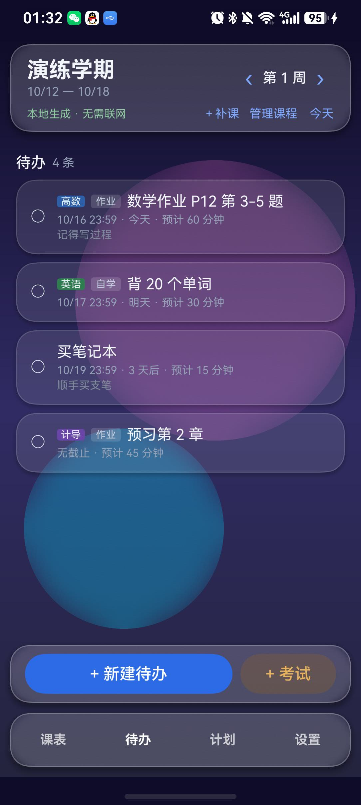
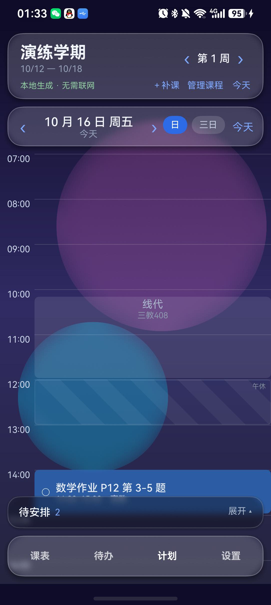
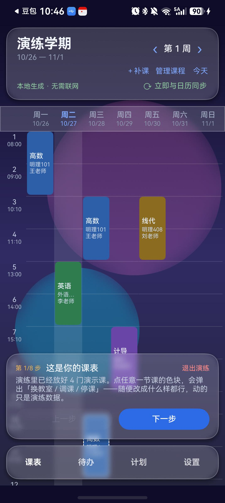
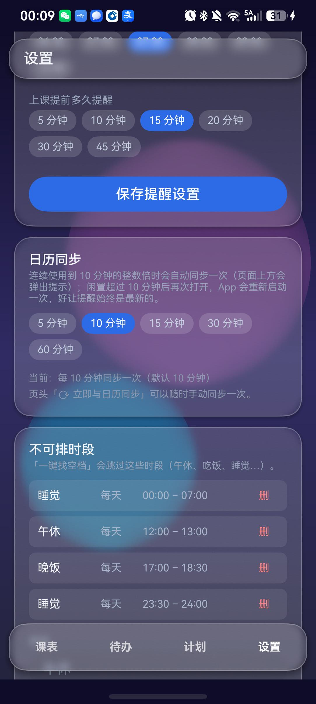

# ClassOUT

**一款纯离线、无广告、不需要联网的鸿蒙（HarmonyOS / ArkTS）「课表 + 待办 + 计划」三合一 App。**

数据只存在你自己的手机里：不联网、不上传、不需要注册、不需要账号。
第一次打开是**一张空课表**，跟着下面「从零开始」四步走一遍，五分钟就能用起来。

- 🗓 **课表**：多时段、单双周、习题课；某一周临时**停课 / 换教室 / 调课 / 补课**，不动规则。
- ✅ **待办**：下课自动生成（可自定义模板与截止规则）、手写备注、**自定义类型**、考试带固定时间段。
- 🧩 **计划**：把待办拖进时间轴；单日 / 三日视图、跨天拖拽、找空档、对半分、双指缩放改时长。
- 🎨 **离线也好看**：深色玻璃态、自定义照片背景、首页标语、可一键关掉的动效。
- 🔔 **提醒**：写进系统日历，到点由日历响铃（原因见第 8 节）。
- 🧭 **新手演练**：开一个**沙箱**带你走一遍全部流程，退出时沙箱整份丢弃，不碰你的数据。

> **第一次上手？** 首次打开时会问你要不要走一遍**新手演练**；设置页里也随时能进。
> 演练里随便改、随便删，动的只是演示数据。

---

## 目录

1. [装到手机上](#1-装到手机上)
2. [第一次打开：从零开始建课表](#2-第一次打开从零开始建课表)
3. [课表页](#3-课表页)
4. [待办页](#4-待办页)
5. [计划页](#5-计划页)
6. [新手演练（沙箱）](#6-新手演练沙箱)
7. [设置页](#7-设置页)
8. [数据、隐私与备份](#8-数据隐私与备份)
9. [常见问题](#9-常见问题)
10. [许可证与第三方声明](#10-许可证与第三方声明)
11. [给开发者](#11-给开发者)

---

## 1. 装到手机上

> ⚠️ **目前还没有上架应用市场**，需要用数据线从电脑装一次（调试签名）。
> 签名只在**开着开发者模式**的设备上能运行。

1. 手机上打开「开发者模式」与「USB 调试」：设置 → 关于手机 → 连点「版本号」7 次，
   再到 设置 → 系统和更新 → 开发人员选项 里打开 **USB 调试**。
2. 用数据线连电脑，在命令行里执行：

   ```bash
   hdc list targets          # 应该能看到你的设备序列号
   hdc install entry-default-signed.hap
   ```

3. 桌面上出现 **ClassOUT** 图标，打开即可。

---

## 2. 第一次打开：从零开始建课表

第一次打开只有**一个空学期**（默认叫「我的学期」，起始日＝本周一，16 周）。
四个入口都在课表页顶部的 **「管理课程」**：


### 第 1 步：确认学期和时间

- **学期**：改名字、开学日期（用系统日期选择器选，会自动吸附到最近的周一）、
  总周数、每周第一天、要不要显示周末。开学日期决定「第几周」怎么算。
- **上课节次时间**：默认是 12 节作息（第 9、12 节是机动节次，格子更矮）。
  可以逐节改起止时间，也可以加一节、删一节 —— 换学校、换作息都不用等更新。

### 第 2 步：新增课程

点右上角 **「+ 新增课程」**：

| 字段 | 说明 |
|---|---|
| 课程名（全称） | 例如「高等数学」 |
| 简称 | 显示在课表格子里，短一点（例如「高数」） |
| 教师 / 默认地点 | 可留空 |
| 颜色 | 10 个色板里挑一个，课表格子会用它上色 |
| 下课自动生成待办 | 打开后，每上完一节会自动生成一条待办（见第 4 节） |
| 虚拟课程 | 「不定时上课」的课（例如网课）：不排固定时间，课时数用滑条定（1–50 讲），自己在计划页安排 |

往下是 **「上课时段」**：点「+ 添加时段」选星期几 + 起止节次 + 生效周次
（`1-16` 表示每周，`1-16单` 表示单周，`1-8,10-16` 表示跳过第 9 周），
还能标记**习题课**（课表上是白色虚线框）。一门课可以有多个时段。

### 第 3 步（可选）：配「生成模板」

同一个页面往下是 **「待办生成模板」**：写一个标题模板 + 截止规则 + 预计耗时，
下课之后就会自动生成待办。标题里可以用变量：

- `%D` = 上课那天的日期（生成出来形如「10.13作业」）
- `%c` = 课程简称，`%N` = 第几次，`%R` = 教室 …
- 右上角的按钮可以插入变量，下面有**实时预览**：看到什么就生成什么。

### 第 4 步（可选）：设不可排时段

到 **设置页 → 不可排时段** 里加「午休」「睡觉」这类时间（时间用**系统时间滚轮**选）。
计划页会用淡淡的斜纹把它们标出来，安排待办时会自动避开。

---

## 3. 课表页



- 顶部是学期与周次：`‹ 第 N 周 ›` 换周，「今天」跳回本周。
- 格子上的信息：**简称 + 地点 + 教师**；习题课是白色虚线框。
- 底部四个标签：**课表 / 待办 / 计划 / 设置**。
- 页头那一大块下面还有一行小字：**`本地生成 · 无需联网`** 和 **`⟳ 立即与日历同步`**。
  点后者会立刻把上课与截止提醒重排一遍（页面上方弹出「正在与系统日历同步…」，
  动画和启动页那个一样；平时 App 也会按「设置 → 日历同步」的间隔自己同步）。

### 只改某一周：点课表格子

点任意一节课的色块，弹出面板：

| 想做什么 | 怎么做 |
|---|---|
| **换教室** | 在「换教室（只改这一周）」里填地点 → 「换到这儿」 |
| **停课** | 点「本周停课」 |
| **调课** | 选「调到哪一天」+ 起止节次 → 「只挪这一天」 |
| **补课** | 顶部 **`＋补课`**：选课程 / 星期几 / 起止节次 |
| **撤销** | 面板底部「撤销这节课的调整」 |

- 这些改动**只影响当前这一周**，不会动你的课程规则；课程表上被改过的那节，
  面板顶部会标出「原定 X 月 X 日，被调过」。
- 补课那节的按钮会变成「**改到这一天 / 取消这次补课**」——它本身没有规则可停。
- 顶部的 **`本周调整 N`** 能看到这一周改过哪些，逐条撤销。

---

## 4. 待办页



从上到下分四块：

- **待确认**：按「生成模板」自动生成、还没确认的（确认了才进入下面的待办）。
- **即将考试**：考试类待办显示倒计时 + 考试时间段（形如 `10 月 22 日 09:00–11:00`）。
- **待办**：正在做的事；左边圆圈点一下 = 完成。
- **已完成**：完成的事不会消失，加灰划掉留在最下面，可以**恢复**或**删除**。

底部两个按钮：**「+ 新建待办」**和 **「+ 考试」**。
每次切到待办页，App 会**当场补生成一遍**「下课自动生成」的待办（不用等到下次启动），
所以下课后切过来就能看到新的「待确认」。


一条待办可以填这些：

| 字段 | 说明 |
|---|---|
| 标题 | 必填 |
| **类型** | 内置 **作业 / 自学 / 考试 / 无**；还能自己加（见下） |
| **备注** | 随便记点什么（自动生成的待办备注是空的，要你自己写）。默认是**单行输入框**，点右边「展开 ▾」变成**可上下滚的大文本框**；折叠/展开会被记住，计划页看这块时也是同一个状态 |
| 截止 | 今天/明天/本周日/3 天后/无截止，或「自定义…」用系统日期+时间选择器（分钟不限） |
| 预计耗时 | 15–600 分钟，按 5 分钟对齐；也能直接填一个自定义分钟数 |
| 所属课程 | 选一门课，卡片上会显示它的小色标 |
| 考试 | 类型选「考试」时改填**开始 / 结束**两个时刻（保存后自动排进计划视图） |

> **自定义类型**：类型那一排最后是 **「＋ 新建类型」**，点开就能加一个 ——
> 这是**全局生效**的，之后所有待办都能选它。不想要的类型去「设置 → 待办类型」里删；
> **删掉时，用了它的待办会改成「无」**。

---

## 5. 计划页

一天一条时间轴。**把「待安排」里的待办安排进网格就排好了。**



- **日 / 三日**：右上角切换。三日视图一次看三天，可以把待办**横向拖到另一天**。
- **安排待办**：底部「待安排」点开 → 先点一条待办选中 → 再点网格上的空白处；
  也可以长按待办卡直接拖进去（落点会吸附到 15 分钟刻度）。
- **⚡ 找空档**：自动挑一个不与课程、也不与「不可排时段」冲突的位置。
- **选中与编辑**：点一下块 = 选中（黑框），再点一下 = 右侧滑出**属性面板**：
  改日期 / 开始时间 / 时长 / 截止时间，标记完成、移除此块、删除整个待办。

在块上能做的几种操作（新手演练第 5、6 步会带你走一遍）：

| 想做什么 | 怎么做 |
|---|---|
| 选中一块 | 点一下，出现黑框（再点一下才开属性面板） |
| 改时间 | **长按选中的块**上下拖；拖到屏幕上下边缘会自动滚时间轴（1 分钟 = 1vp，落点吸附 15 分钟） |
| 改时长 | 在块上**双指张合**：撑开变长、捏拢变短，5 分钟一档，开始时间不动 |
| 同一天拆两段 | 打开属性面板 → **「对半分」**：把这块拆成**相邻的两块**（时长自动平分到 5 分钟档）；拆出来的第二块可以再拖到别的时间或别的天 |
| 分到两天做 | 把第二块拖到三日视图的另一列，或用属性面板里的「日期 ‹ ›」 |

> 改完时间后，待办卡片上的「预计 N 分钟」会按它**所有块时长之和**自动更新。
- **截止标记**：同一天同一时刻的截止会**合并成一行**「⚑ N 项截止」，点它展开完整列表，
  点其中一条直接跳到那条待办的编辑窗。**三日视图里每列显示各自那天的**截止。
  考试**不算截止**（它有自己的开始/结束时间），所以不会出现在这些标记里，
  计划块属性面板里也不会给考试显示「截止时间」。
- **不可排时段**：设置里配的「午休 / 睡觉」用**淡斜纹**标出来（单日与三日都有）。
- **时间范围（上下限）**：网格从几点画到几点，可以在「设置 → 计划页时间范围」里
  按**半小时**调（默认 07:00–24:00）。范围之外的内容会被裁掉。

---

## 6. 新手演练（沙箱）



第一次用、或者想看看「某个功能到底怎么用」时，进设置页 → **新手引导 → 开始演练**。

- 它会开一个**沙箱**：里面有几门演示课、几条演示待办，和你的数据**完全隔离**。
- 底部挂着一条**引导条**：`第 n/8 步 + 这一步要做什么`，每一步自动切到对应的标签页，
  跟着点就行（上一步 / 下一步 / 退出演练）。
  其中第 5、6 步都在计划页：第 5 步教你把待办排进时间轴，第 6 步专门走一遍
  **「对半分」拆块**和**双指张合改时长**（这两样在别处没有入口，值得走一步）。
- 演练里**随便改、随便删**，包括停课、删待办、改类型 —— 动的都只是沙箱。
- 点「完成演练」或「退出演练」：沙箱整份丢弃，回到你自己的课表；
  **你的真实数据一点都不会变**（演练期间连的是另一个数据库）。

---

## 7. 设置页


| 卡片 | 能做什么 |
|---|---|
| **背景** | 从相册选一张照片当背景（会拷进 App 内部保存，**不联网、也不需要相册权限**）；可以选区域 / 调位置与缩放；也能一键恢复默认渐变 |
| **首页标语** | 改启动页 `ClassOUT` 下面那一行字，上限按**显示宽度**算：16 个汉字或 32 个英文字母；留空恢复默认 |
| **动画** | **一键关掉全部动效**（抽屉、托盘、列表增删、打字机、背景光晕漂移都会退化成直接切换，更省电） |
| **提醒** | 每日简报时间、上课提前多少分钟提醒 |
| **日历同步** | 同步节奏 `n` 分钟（5 / 10 / 15 / 30 / 60，默认 10）。用 App 连续到 `n` 的整数倍时自动同步一次；**闲置超过 `n` 分钟后再次打开，App 会自己重新启动一次**（重排一遍提醒，保证不漏） |
| **不可排时段** | 加「午休 / 睡觉」这类时间（时间用**系统时间滚轮**选），计划页会避开并淡淡标出 |
| **待办类型** | 加 / 删**自定义待办类型**（内置的作业 / 自学 / 考试 / 无不能删）；删一个类型时，用了它的待办会改成「无」 |
| **计划页时间范围** | 计划网格的**上下限**，按半小时步进（默认 07:00–24:00）；和「不可排时段」是两件事 |
| **新手引导** | 进「演练」（见第 6 节） |
| **关于** | 版本号 + **隐私政策**（应用内可读全文） |

再往下一段就是**提醒**和**日历同步**这两张卡：



> 截图里的 `10 分钟` 就是默认值。页头那个「⟳ 立即与日历同步」随时可以手动来一次。

---

## 8. 数据、隐私与备份

- **完全离线**：没有任何联网代码，没有账号，没有统计上报。
  **完整隐私政策见 [PRIVACY.md](PRIVACY.md)**（应用内也在「设置 → 关于 → 隐私政策」）；
  **删除 / 导出数据（用户权利）见 [PRIVACY_RIGHTS.md](PRIVACY_RIGHTS.md)** ——
  应用市场填「用户权利网址」用的就是这份。
- **数据在哪**：全部在这个 App 的私有沙盒里（SQLite 数据库 + 你选的背景图副本），
  卸载 App 就会一起删掉。开发者没有服务器，也没有任何途径访问。
- **备份**：`管理课程 → 备份与恢复 → 导出备份` 会生成一个 JSON 文件，
  可以用数据线拷到电脑保存；换机或重装后用「恢复」导入。
  **换手机之前请务必导出一次。**
- **提醒为什么在系统日历里**：鸿蒙对普通应用的「代理提醒」配额是 0 条，
  所以 ClassOUT 把上课与作业截止的提醒**写进系统日历**，由日历负责到点响铃。
  你可以在日历里看到形如「12:45 高等数学 还有 15 分钟上课 · ClassOUT」的事件；
  每次同步只删自己建的那些（带 `ClassOUT` 标记）。
  同步**什么时候发生**：打开 App 时、你点页头「⟳ 立即与日历同步」时、
  以及用 App 连续到「设置 → 日历同步」里那个 `n` 分钟的整数倍时（会弹一下提示）。

---

## 9. 常见问题

**Q：待办没有自动生成？**
A：三条检查 —— ① 课程里「下课自动生成待办」是否打开；② 该课程有没有配「生成模板」；
③ 生成的待办会先出现在**待办页的「待确认」**里，确认之后才进「待办」。

**Q：上课提醒没响？**
A：提醒写在**系统日历**里，请确认日历的通知权限开着；
另外提醒是**下次打开 App 时**重排的（鸿蒙不允许 App 后台常驻），所以刚改完课程不会立刻生效。

**Q：怎么把一条待办拆成两天做？**
A：在计划页把「待安排」里的它拖到某一天；再切到三日视图，把它拖到/排到另一天。
想要同一天拆成两段，用编辑面板里的「**对半分**」。

**Q：排错了 / 排重了怎么办？**
A：计划页点开那一块 → 「移除此块」。待办卡片上的「预计 N 分钟」等于它**所有块时长之和**，
所以删掉多余的块，预计时间会自己回落。

**Q：删掉一个待办类型，之前的待办会怎样？**
A：会**改成「无」**（不会留下一个选不到的类型）。这条在设置页的删除确认里会提示。

**Q：考试的「截止」去哪了？**
A：考试不用截止 —— 它是一段**固定的起止时间**（在待办页用「开始 / 结束」两个选择器填），
保存后会自动排进计划视图。所以网格上的「⚑ 截止」标记、计划块属性面板里的「截止时间」、
每日简报的「今天截止」都**不会**把考试算进去。

**Q：用着用着上方弹出一个「正在与系统日历同步」？**
A：是正常的 —— 你连续用了 `n` 分钟（默认 10 分钟，可在「设置 → 日历同步」改），
App 就自动把提醒重排一遍，免得你在外面改了课、日历却还是旧的。弹一下自己就消失，不用管。

**Q：隔了一会儿再点开，怎么像重新启动了一次？**
A：故意做的。闲置超过同一个 `n` 分钟之后，App 下次打开会**重新走一遍启动流程**
（重排日历 + 补生成下课待办）。鸿蒙不允许 App 在后台常驻，所以这是「提醒不过期」的代价。
不想这么频繁，就把「设置 → 日历同步」调大一点。

**Q：新手演练会不会动我的数据？**
A：不会。演练期间 App 连的是一个**空的沙箱数据库**，你的真实数据库全程不打开；
退出（或者中途被杀掉、下次启动）时沙箱会被整个删掉。

**Q：我把计划页时间范围调窄了，有些课不见了？**
A：是的 —— 超出上下限的课程与计划块会被裁掉（只是不画出来，数据还在）。
把范围调回去就又能看见。

**Q：截图里的课表怎么和我不一样？**
A：说明书截图用的是**演练沙箱里的演示数据**（高等数学 / 王老师 这类），不是任何人的真实课表。

---

## 10. 许可证与第三方声明

- **代码**：MIT License（见 [LICENSE](LICENSE)）—— 你可以自由使用、修改、再发布，只需保留版权声明。
- **应用图标**：**完全自绘**（只有渐变与圆角格子，生成脚本 [`tools/make-icon.py`](tools/make-icon.py)），
  不包含任何第三方美术素材，随代码一起按 MIT 授权。
- **第三方 SDK**：没有。本 App 不集成统计、广告、崩溃上报。
- 本 App 不内置任何课表数据、不联网、不收集任何信息。

---

## 11. 给开发者

这是一个纯命令行开发的项目（没有 DevEco Studio，Linux 上跑）：

```bash
./build.sh clean && ./build.sh assembleHap   # 编译（ERROR: 0 / 警告 6 条）
./tools/domain-check/run.sh                  # 离线断言（必须全绿）
./sign-and-install.sh --install              # 调试签名 + 装机
./tools/publish-wizard.sh                    # 上架向导（发布签名 → .app）
```

- **上架清单**（AGC 逐条核对 / 填报文案 / 权限与隐私标签 / 素材）：[`STORE.md`](STORE.md)
- 交接文档（架构、坑、已验证/未验证清单）：[`HANDOFF.md`](HANDOFF.md)
- 签名与上架：[`signing/README.md`](signing/README.md)、[`signing/release/README.md`](signing/release/README.md)
- 计划页设计取舍：[`PLAN_REDESIGN.md`](PLAN_REDESIGN.md)

---

**版本**：v1.5.1 · 全离线 · 鸿蒙原生 ArkTS
